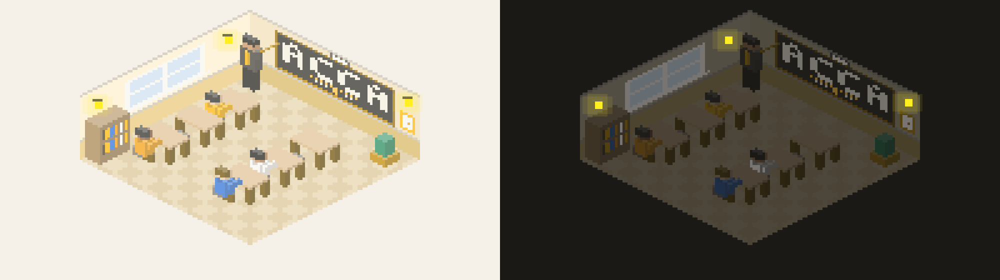

# sapp-claude-plugins

Kho plugin Claude Code của SAPP Academy: các plugin và mod cài cho toàn tổ chức.
Kho này là một marketplace tên `sapp`, hiện có một plugin là `sapp-brand`.

Tạo bởi SAPP IT Department, © 2026.

## sapp-brand

`sapp-brand` là một mod (plugin có `hooks/register.js`) đổi nhận diện nơi làm việc của SAPP trong Claude Code. Nó chỉ làm bốn việc:

| Việc | Nơi hiện |
| :-- | :-- |
| Màu giao diện SAPP, sáng và tối | Tab Code của ứng dụng Desktop |
| Nền động: lớp học ACCA kiểu pixel art isometric (bảng đen ghi ACCA, bàn học, học viên), có ánh đèn, bụi phấn trôi và vệt sáng nhẹ quanh con trỏ | Tab Code của ứng dụng Desktop |
| Dòng credit cố định "Tạo bởi SAPP IT Department, © 2026" (dòng trạng thái dưới ô nhập) | Mọi nơi Claude Code vẽ giao diện |
| Chữ khi Claude đang xử lý: "SAPP đang xử lý…" thay cho từ quay vòng mặc định | Mọi nơi Claude Code vẽ giao diện |



Ảnh trên là một khung hình tĩnh dựng từ chính Svg của nền, chưa có phần chuyển động.

Mod không làm gì khác: không đăng ký hook nào đọc hay đổi hành động của Claude (`tool.call`, `tool.check`, `prompt.submit`...), không gọi mạng, không đọc tệp ngoài thư mục plugin, không chạy tiến trình. Nền được giữ nhạt để chữ hội thoại vẫn dễ đọc ở cả hai chế độ; cảnh không nhấp nháy và đứng yên khi người dùng bật giảm chuyển động.

### Màu

Màu lấy từ SAPP Academy Design System (skill `sapp-design-system`, tệp `references/tokens.css`): vàng SAPP `#FFB700`, ink ấm `#1A1916`, nền kem `#FAF8F3`, cùng thang ink và bốn màu ngữ nghĩa. Giá trị nằm trong [`plugins/sapp-brand/tokens.json`](plugins/sapp-brand/tokens.json). Mod chỉ nạp được tệp mã, nên bản nạp thật là `hooks/tokens.js`; một bài test fail khi hai bản lệch nhau. Từ các màu này, `makeColors` của Claude Code dựng cả bảng màu giao diện, nên các màu nhấn (vàng, đỏ, xanh) được chỉnh độ sáng cho đủ tương phản.

## Dùng thử

Trong Claude Code:

```text
/plugin marketplace add sapp-academy-it/sapp-claude-plugins
/plugin install sapp-brand@sapp
```

Cần Claude Code có mod (từ 2.1.286); đã kiểm với 2.1.332.

## Triển khai cho cả tổ chức

Quản trị viên dán đoạn sau vào managed settings (claude.ai admin console hoặc `managed-settings.json`):

```json
{
  "extraKnownMarketplaces": {
    "sapp": {
      "source": {
        "source": "github",
        "repo": "sapp-academy-it/sapp-claude-plugins",
        "ref": "<SHA 40 ký tự của commit đã duyệt trên main>"
      }
    }
  },
  "enabledPlugins": { "sapp-brand@sapp": true },
  "appendPlugins": ["sapp-brand@sapp"]
}
```

- `extraKnownMarketplaces` khai báo marketplace `sapp` từ kho GitHub này. `ref` ghim marketplace vào đúng một commit: thay `<SHA ...>` bằng SHA đầy đủ (40 ký tự thường) của commit đã duyệt. Mỗi bản phát hành mới đổi SHA này trong cài đặt quản trị; không đổi thì máy người dùng vẫn ở bản đã ghim. Ghim bằng SHA cần Claude Code 2.1.324 trở lên; bản cũ hơn không nạp được marketplace ghim kiểu này.
- `enabledPlugins` bật `sapp-brand` cho mọi người nhận cài đặt.
- `appendPlugins` làm mod chạy sau mod của người dùng. Theo tài liệu, khai báo ở `prependPlugins` hoặc `appendPlugins` đều đủ để một mod từ marketplace GitHub tính là mod của tổ chức (cùng với hai khóa trên, trên Claude Code 2.1.324 trở lên). `sapp-brand` chỉ vẽ giao diện nên không cần chạy trước mod khác; dùng `appendPlugins` cũng không buộc phải liệt kê `sec-default@builtin`.

Cấu trúc theo [Manage mods for your organization](https://code.claude.com/docs/en/plugins/mods/admin) và [Marketplace reference](https://code.claude.com/docs/en/plugins/marketplace-reference).

## Phát triển

```text
npm test                                  # node --test, không cần mạng
claude plugin validate .                  # marketplace
claude plugin validate plugins/sapp-brand # plugin
npm run preview                           # dựng lại preview.png (cần rsvg-convert và ImageMagick 7)
```

Cảnh nền dựng bằng mã trong `plugins/sapp-brand/hooks/scene.js`; chuyển động là shader `hooks/backdrop.shader.ts`.
