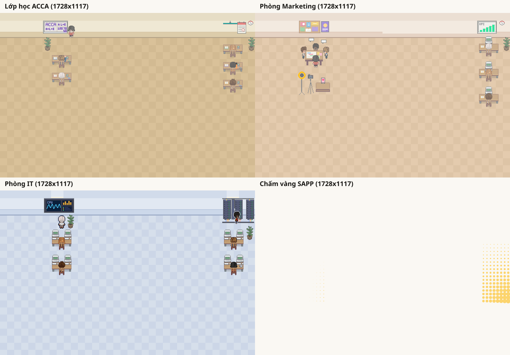

# sapp-claude-plugins

Kho plugin Claude Code của SAPP Academy. Kho này là một marketplace tên `sapp`, hiện có một plugin là `sapp-mod`.

Tạo bởi SAPP IT Department, © 2026.

## sapp-mod

`sapp-mod` là bộ giao diện (theme) SAPP cho Claude Code, dưới dạng mod (plugin có `hooks/register.js`). Có bốn giao diện, mỗi giao diện có màu sáng và tối theo cửa sổ:

| Mã | Tên |
| :-- | :-- |
| `acca-classroom` | Lớp học ACCA (mặc định) |
| `marketing-room` | Phòng Marketing |
| `it-room` | Phòng IT |
| `sapp-dots` | Chấm vàng SAPP |



Ảnh trên là khung hình tĩnh của từng giao diện (chưa có chuyển động).

Nơi hiện:

- **Tab Code của Claude Desktop và trên mobile:** giao diện đầy đủ (nền và màu), cộng dòng credit "Tạo bởi SAPP IT Department, © 2026" và chữ "SAPP đang xử lý…" khi Claude làm việc.
- **Terminal:** chỉ có dòng credit và chữ "SAPP đang xử lý…"; nền và màu không hiện.

Cần Claude Code từ **2.1.330** trở lên.

### Lệnh

```text
/sapp-theme                 # liệt kê các giao diện, đánh dấu cái đang dùng
/sapp-theme it-room         # đổi theo mã, theo số trong danh sách hoặc theo tên
/sapp-help                  # trang trợ giúp SAPP và hướng dẫn "Dùng Claude hiệu quả"
```

Lựa chọn giao diện được lưu và dùng lại ở các phiên sau. `/sapp-help` không tốn lượt nào của Claude.

## Cài cho một người

Trong Claude Code:

```text
/plugin marketplace add sapp-academy-it/sapp-claude-plugins
/plugin install sapp-mod@sapp
```

Cập nhật: `claude plugin update sapp-mod@sapp`, rồi khởi động lại Claude Code.

## Cài cho cả tổ chức

Quản trị viên (gói Team hoặc Enterprise, vai trò Owner) dán đoạn sau vào claude.ai: Organization settings > Claude Code > Managed settings, làm một lần cho tổ chức. Cũng có thể đặt vào tệp managed settings hoặc chính sách MDM (nếu managed settings từ máy chủ đã gửi bất kỳ khóa nào, các khóa plugin trong tệp hoặc MDM bị bỏ qua).

```json
{
  "extraKnownMarketplaces": {
    "sapp": {
      "source": {
        "source": "github",
        "repo": "sapp-academy-it/sapp-claude-plugins",
        "ref": "<SHA đầy đủ 40 ký tự của commit đã duyệt>"
      }
    }
  },
  "enabledPlugins": { "sapp-mod@sapp": true },
  "appendPlugins": ["sapp-mod@sapp"],
  "requiredMinimumVersion": "2.1.330"
}
```

- `ref` ghim marketplace vào một commit đã duyệt. Muốn phát hành bản mới, đổi `ref` sang SHA merge mới. Mỗi bản phát hành đều tăng `version` trong `plugin.json`, vì bản cài được lưu theo số phiên bản.
- `appendPlugins` làm `sapp-mod` thành mod của tổ chức, và phải đi cùng hai khóa `extraKnownMarketplaces` và `enabledPlugins` ở trên.
- `requiredMinimumVersion` là tùy chọn và ảnh hưởng cả tổ chức: mọi máy nhận cài đặt này mà chạy Claude Code cũ hơn 2.1.330 sẽ không mở được Claude Code (không riêng `sapp-mod`). Cập nhật các máy trước rồi mới bật.
- Kiểm trên máy thành viên: `/plugin` hiện `sapp-mod` kèm số phiên bản, và `/sapp-theme` chạy được.
- Tắt: đổi thành `"sapp-mod@sapp": false`.

## Khi sapp-mod không hiện

1. Ngay sau lần cài đầu bằng managed settings, mod có thể chưa nạp ở phiên đầu: thoát hẳn Claude Code (với Desktop, thoát cả biểu tượng ở khay hệ thống) rồi mở lại.
2. Chạy `claude plugin ...` bằng Claude Code CLI độc lập mà cũ hơn bản trong Desktop có thể làm `sapp-mod` được quản lý bị rơi ra: cập nhật CLI trước (`claude update`) hoặc quản lý plugin ngay trong Desktop. Nếu đã rơi ra, thoát hẳn rồi mở lại Desktop; mod trở lại ở lần khởi động sau.
3. Nếu vẫn không hiện, xem `/plugin`: `sapp-mod` phải hiện ở phạm vi managed, kèm số phiên bản hiện tại.

## Đưa hướng dẫn lên claude.ai

Mod chỉ chạy trong Claude Code, không chạy trong chat claude.ai. Chat chỉ nạp được skill, nên chỉ hướng dẫn `sapp-ai-guide` (một tệp `SKILL.md`) đi được. Kho này là public, mà đồng bộ marketplace từ GitHub trong Organization settings chỉ nhận kho private hoặc internal, nên tải zip lên bằng tay (Owner của gói Team hoặc Enterprise):

1. Nén thư mục skill, tên thư mục trùng tên skill: `cd plugins/sapp-mod/skills && zip -r sapp-ai-guide.zip sapp-ai-guide`.
2. Vào Organization settings > Plugins & skills > Policy, bảo đảm Skills đang bật.
3. Ở tab Inventory chọn Add > Upload a skill, chọn tệp zip, rồi đặt Default access cho thành viên (skill vừa tải lên có thể hiện trước ở tab Organization skills) (Available to install, Installed by default hoặc Required).
4. Mỗi lần sửa `SKILL.md`, tạo zip mới và chọn Upload new version ở trang của skill.

Không phải Owner thì tự dùng: Customize > Skills > Create skill > Upload a skill, với cùng tệp zip. Đừng tải cả plugin `sapp-mod` lên bằng Upload a plugin.

## Báo vấn đề

Mở một issue tại https://github.com/sapp-academy-it/sapp-claude-plugins/issues

## Phát triển

```text
npm test                    # node --test, không cần mạng
npm run build:scene         # sinh lại các cảnh pixel từ sprite
npm run build:guide         # chép SKILL.md vào hooks/guide.js (sửa SKILL.md xong phải chạy)
npm run preview             # dựng lại preview.png
```

Quy tắc phiên bản tối thiểu: mod chỉ được đăng ký sự kiện và gọi lệnh `$` nằm trong danh sách của `plugins/sapp-mod/test/engine-floor.test.js` (các thứ có trên Claude Code 2.1.330); thêm cái mới thì phải kiểm trên 2.1.330 trước.

## Ghi công

Nhân vật và đồ nội thất của các cảnh nền là sprite pixel từ dự án pixel-agents, giấy phép MIT, Copyright (c) 2026 Pablo De Lucca. Toàn văn giấy phép: [`plugins/sapp-mod/assets/LICENSE-pixel-agents.txt`](plugins/sapp-mod/assets/LICENSE-pixel-agents.txt).

Cách tổ chức bộ giao diện học từ ví dụ `theme-examples` của Anthropic trong [claude-plugins-official](https://github.com/anthropics/claude-plugins-official/tree/73c8cf3ea7e296057b467990f2f5d61b4c922260/plugins/theme-examples), giấy phép Apache License 2.0; mã của `sapp-mod` được viết lại, không sao chép nguyên văn tệp nào.
